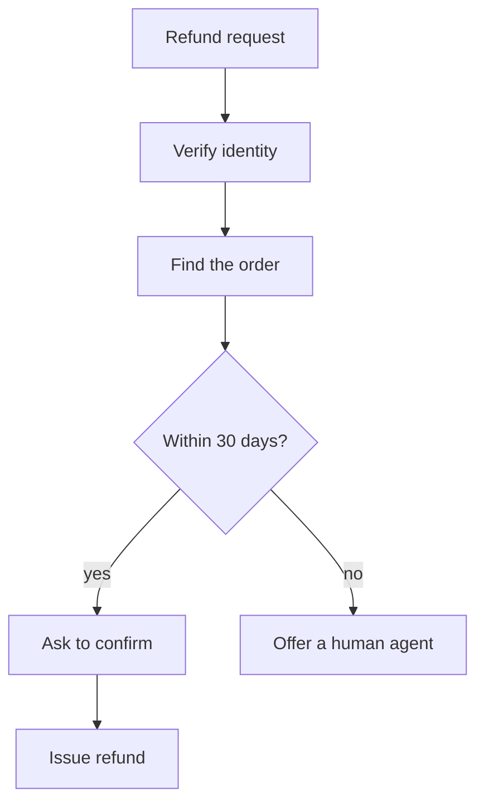
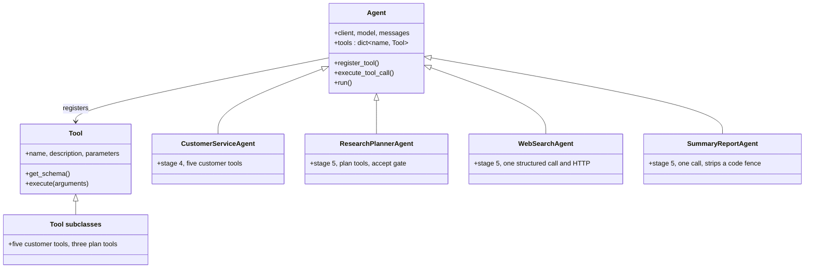

# Course: Customer service and research agents (03-ai-agents) by business domain

## 1. Course overview

This course reads the 03-ai-agents folder of mschwarzmueller/ai-agents-workflows-course starting from the business problem, then shows the code that serves each requirement.

The repo teaches AI agents through two business problems, an online shop's customer service and a research planner, and this course starts from those problems instead of from the code.

**What the repo contains.** Five folders, each a step up. Stages 1 and 2 use a weather lookup to teach tool calling. Stages 3 and 4 build the customer service agent on a small SQLite database. Stage 5 builds the research pipeline of three agents.

**Who it is for.** Engineers who want to see how a business rule such as "refund only within 30 days" ends up in an agent: in code, or only in a prompt.

**Learning goals.** After this course you can:

- list the business capabilities each folder adds and the use case each one serves
- say for every business rule whether code or the prompt enforces it, and why that matters
- read the domain data model and the three SQLite tables behind it
- follow how one user message turns into model calls, tool calls and a database query
- name the gaps between what the business needs and what the sample guarantees

**How to read it.** Business first, code second. Each use case and rule is followed by *cards*: a short excerpt from the repo with its link, then **What it does** and **Hard part**. Links point to the `main` branch of [mschwarzmueller/ai-agents-workflows-course](https://github.com/mschwarzmueller/ai-agents-workflows-course/tree/main/code/03-ai-agents).

| Section | Question it answers | Code cards |
| --- | --- | --- |
| 2. Domain requirements | What must the agents do for the customer and the researcher? | UC-1 to UC-12 |
| 3. Business rules | Which rules are enforced in code, which only in prompts? | none, a drawn flow |
| 4. Domain model | What data exists and how long does it live? | D-1 |
| 5. Non-functional requirements | What trust, audit and correctness does the business need? | none |
| 6. The five stages | How did each folder add a capability? | S-1 to S-5 |
| 7. Class diagram | How are the classes related? | none, a drawn diagram |
| 8. Gaps and exercises | What is missing, and what can you build? | none |

## 2. Domain requirements

There are two domains and twelve use cases: six for the customer, six for the researcher. The criteria are read from the prompts and tools in the repo, because the repo has no requirements file.

| ID | Actor | Use case | Acceptance criterion | Where in the repo |
| --- | --- | --- | --- | --- |
| UC-1 | Customer | Verify identity | A full name and PIN return the customer id, or -1 when nothing matches | Stages 3 and 4, `verify_customer` |
| UC-2 | Customer | View order history | A verified customer sees every order: id, date, product, amount | Stages 3 and 4, `get_orders` |
| UC-3 | Customer | Check refund eligibility | An order is eligible if it is the customer's own and was placed 30 days ago or less | Stages 3 and 4, `check_refund_eligibility` |
| UC-4 | Customer | Get a refund | After eligibility and the customer's confirmation, a refund is issued (the sample prints a line) | Stages 3 and 4, `issue_refund` |
| UC-5 | Customer | Share feedback | Feedback is received and the reply is "Thank you for your feedback!" (the sample prints it) | Stages 3 and 4, `share_feedback` |
| UC-6 | Customer | Be declined or handed over | Unrelated requests get a fixed refusal sentence; anything the agent cannot do goes to a human agent | System prompt only |
| UC-7 | Researcher | Draft a research plan | The agent refines a plan with the user, does not answer the question, and covers core topics, related topics, topics to avoid and a time frame | Stage 5, `ResearchPlannerAgent` prompt |
| UC-8 | Researcher | Keep plans | Plans are stored, listed and deleted by id | Stage 5, three plan tools and `database.py` |
| UC-9 | Researcher | Accept the plan | The user types `accept` and receives only the final plan | Stage 5, `ResearchPlannerAgent.run` |
| UC-10 | Researcher | Derive search settings | Search terms and a freshness window come from the plan | Stage 5, `WebSearchAgent` |
| UC-11 | Researcher | Search the web | Each term is searched, ten results at a time, web and news results combined | Stage 5, `WebSearchAgent.run` |
| UC-12 | Researcher | Get a summary with links | A Markdown report with each URL beside its text is saved to `summary_report.md` | Stage 5, `SummaryReportAgent` |

#### Card UC-1: Verify identity

Source: [`03-multi-tool-versatile/main.py`](https://github.com/mschwarzmueller/ai-agents-workflows-course/blob/main/code/03-ai-agents/03-multi-tool-versatile/main.py)

```python
    first_name, last_name = name.lower().split()
    cursor.execute(
        "SELECT id FROM customers WHERE LOWER(first_name) = ? AND LOWER(last_name) = ? AND pin = ?",
        (first_name, last_name, pin),
    )
    result = cursor.fetchone()
    conn.close()
    if result:
        return result[0]
    return -1
```

**What it does.** It splits the full name into two words, looks for a customer with that first name, last name and PIN, ignoring case, and returns the id, or -1.

**Hard part.** The name must be exactly two words, otherwise the unpacking raises an error that the caller turns into an error message for the model. The result -1 is a magic value, and the code never records that a customer is now verified: the model only remembers the id in the conversation. Nothing limits how many PINs can be tried.

#### Card UC-2: View order history

Source: [`03-multi-tool-versatile/main.py`](https://github.com/mschwarzmueller/ai-agents-workflows-course/blob/main/code/03-ai-agents/03-multi-tool-versatile/main.py)

```python
    cursor.execute(
        "SELECT * FROM orders WHERE customer_id = ?", (customer_id,))
    orders = [dict(row) for row in cursor.fetchall()]
```

**What it does.** It returns every order row of the given customer id as a list of dictionaries.

**Hard part.** The function accepts any integer. Nothing checks that this id came from a successful `verify_customer`, so the rule "never expose data to unverified customers" is carried by the prompt, not by this code (section 3). `SELECT *` also hands every column to the model, so any column added later is sent to the model provider automatically.

#### Card UC-3: Check refund eligibility

Source: [`03-multi-tool-versatile/main.py`](https://github.com/mschwarzmueller/ai-agents-workflows-course/blob/main/code/03-ai-agents/03-multi-tool-versatile/main.py)

```python
    cursor.execute(
        "SELECT date FROM orders WHERE id = ? AND customer_id = ?", (
            order_id, customer_id)
    )
    result = cursor.fetchone()
    conn.close()
    if not result:
        return False
    order_date = datetime.fromisoformat(result[0])
    return (datetime.now() - order_date).days <= 30
```

**What it does.** It looks up the order only if it belongs to the customer, then answers true when the order is at most 30 whole days old.

**Hard part.** This is one of the two places where a business rule really lives in code. Both ids are in the query, so someone else's order simply returns false, which is the right behaviour. The rule counts whole days, so an order placed 30 days and 23 hours ago is still eligible. With the seed data the laptop (10 days) qualifies and the mouse (45 days) does not.

#### Card UC-4: Get a refund

Source: [`03-multi-tool-versatile/main.py`](https://github.com/mschwarzmueller/ai-agents-workflows-course/blob/main/code/03-ai-agents/03-multi-tool-versatile/main.py)

```python
def issue_refund(customer_id: int, order_id: int) -> bool:
    """
    Issues a refund for an order.
    """
    # in reality, this would be stored in some database
    print(f"Refund issued for order {order_id} for customer {customer_id}")
    return True
```

**What it does.** It prints a line and returns true; the comment says a real system would store the refund.

**Hard part.** It does not re-check eligibility or ownership, records nothing, and can be called twice for the same order. "Check eligibility first" and "ask for confirmation first" exist only in the prompt, so a model that skips a step still gets a successful refund.

#### Card UC-6: Be declined or handed over

Source: [`03-multi-tool-versatile/main.py`](https://github.com/mschwarzmueller/ai-agents-workflows-course/blob/main/code/03-ai-agents/03-multi-tool-versatile/main.py), the system prompt

```python
If you can't perform a certain customer or order-related task, you must direct the user to a human agent.
...
If you can't help a customer or if a customer is asking for something that is not related to the customer service, you MUST say "I'm sorry, I can't help with that."
```

**What it does.** Two lines of the prompt define what the agent does when a request is out of scope or beyond its tools.

**Hard part.** There is no code behind this use case. No tool opens a ticket or contacts a human, so "direct the user to a human agent" can only ever be words in a reply. Whether the exact refusal sentence is used depends on the model, and nothing in the code checks it.

#### Card UC-7 and UC-8: Draft a plan and keep plans

Source: [`05-multi-agent/main.py`](https://github.com/mschwarzmueller/ai-agents-workflows-course/blob/main/code/03-ai-agents/05-multi-agent/main.py) and [`05-multi-agent/database.py`](https://github.com/mschwarzmueller/ai-agents-workflows-course/blob/main/code/03-ai-agents/05-multi-agent/database.py)

```python
    def execute(self, arguments: str) -> Dict[str, Any]:
        args = json.loads(arguments)
        try:
            result = database.add_research_plan(
                args["short_summary"], args["details"])
            return result
        except Exception as e:
            return {"status": "error", "message": str(e)}
```

```python
    cursor.execute("INSERT INTO research_plans (short_summary, details) VALUES (?, ?)", (short_summary, details))
    research_plan_id = cursor.lastrowid
```

**What it does.** The planner agent can store a plan with a short title and details; two sibling tools list and delete plans. The prompt tells it to build the plan with the user and not to answer the question itself.

**Hard part.** The `research_plans` table has no user column, so every plan belongs to everybody. The delete function returns nothing, so the tool's output reaches the model as the text "None". Most important for the business flow: the plan that moves on to the next agent is the text the planner writes at the end (card UC-9), not the rows in this table, so stored plans are a notebook beside the flow, not part of it.

#### Card UC-9: Accept the plan

Source: [`05-multi-agent/main.py`](https://github.com/mschwarzmueller/ai-agents-workflows-course/blob/main/code/03-ai-agents/05-multi-agent/main.py)

```python
            elif user_input == "accept":
                print("Research plan accepted. Continuing...")
                prompt = "Please create a final version of the discussed research plan and return JUST that plan, nothing else, no other comments."
                self.messages.append({"role": "user", "content": prompt})
                response = self.client.responses.create(
                    model=self.model,
                    input=self.messages,
                )
                ...
                return response.output_text
```

**What it does.** The literal word `accept` is the human approval. The agent then writes the final plan from the whole conversation and returns that text to the pipeline.

**Hard part.** The approval gate is a string comparison in code, so it is reliable, but what is approved is whatever the model writes after the word. The user can read the final plan only as it is printed: the search starts straight away, with no chance to reject it.

#### Card UC-10: Derive search settings

Source: [`05-multi-agent/main.py`](https://github.com/mschwarzmueller/ai-agents-workflows-course/blob/main/code/03-ai-agents/05-multi-agent/main.py)

```python
class SearchConfig(BaseModel):
    search_terms: list[str]
    freshness: Literal["pd", "pw", "pm", "py"] | str = Field(
        ...,
        description="The freshness of the web search results. pd: past day, ..."
    )
```

```python
        response = self.client.responses.parse(
            model=self.model,
            input=self.messages,
            text_format=SearchConfig,
        )
        search = response.output_parsed
```

**What it does.** The model must answer in the shape of `SearchConfig`: a list of terms and a freshness window. The system prompt includes today's date so the model can turn "last month" into a range.

**Hard part.** `Literal[...] | str` accepts any string, so the allowed codes work as documentation for the model but not as validation; an invalid value goes straight to the search API. Today's date is fixed when the agent object is created, which is fine for one run but wrong for a long-lived process.

#### Card UC-11: Search the web

Source: [`05-multi-agent/main.py`](https://github.com/mschwarzmueller/ai-agents-workflows-course/blob/main/code/03-ai-agents/05-multi-agent/main.py)

```python
            params = {
                "q": search_term,
                "count": 10,
                "freshness": search.freshness,
            }

            response = requests.get(url, headers=headers, params=params)
            result = response.json()
            if "web" in result:
                web_results = result["web"]["results"]
```

**What it does.** For each term it asks the Brave Search API for ten results with the freshness window, then collects web and news results as records of term, url and description.

**Hard part.** There is no timeout and no check of the HTTP status, so a rate-limit or error response is read as if it were a result. Terms are searched one after another, and the same url found by two terms is kept twice. This stage uses no model tool calls at all: the "agent" is one structured model call followed by plain HTTP code.

#### Card UC-12: Get a summary with links

Source: [`05-multi-agent/main.py`](https://github.com/mschwarzmueller/ai-agents-workflows-course/blob/main/code/03-ai-agents/05-multi-agent/main.py)

````python
        report = response.output_text
        if report.startswith("```markdown"):
            report = report[11:]
        if report.endswith("```"):
            report = report[:-3]
        return report
````

**What it does.** The summary agent turns the list of results into a Markdown report; the code then removes a code fence if the model wrapped the report in one.

**Hard part.** The prompt asks for no extra text, yet the code still strips a fence, which shows prompt rules need a safety net in code. The report is built only from search snippets, not from the pages themselves, and the requirement that every URL stays beside its text is again only in the prompt.

## 3. Business rules and where each is enforced

Of 14 business rules in the repo, 5 are enforced in code, 1 only in part, and 8 only in prompts, so most of the business logic depends on the model following instructions.

| ID | Rule | Enforced by | What is missing |
| --- | --- | --- | --- |
| BR-1 | Always verify identity before giving sensitive information | Prompt | No code requires `verify_customer` to have succeeded first |
| BR-2 | Never expose information to unverified customers | Prompt | `get_orders` runs for any id |
| BR-3 | Give no unrelated information; refuse with a fixed sentence | Prompt | The sentence is never checked |
| BR-4 | Never guess customer or order data | Prompt | Nothing compares the reply with tool results |
| BR-5 | Hand over to a human agent when it cannot help | Prompt | No escalation tool or ticket |
| BR-6 | Ask for confirmation before key actions | Prompt | `issue_refund` never asks for a yes |
| BR-7 | Credentials must match name and PIN | Code | Attempts are not limited and the PIN is stored as plain text |
| BR-8 | A refund check covers only the customer's own order | Code | `issue_refund` does not repeat the check |
| BR-9 | Refunds are possible within 30 days of the order | Code | `issue_refund` does not repeat the check |
| BR-10 | The planner builds a plan and does not answer the question | Prompt | No check on the reply |
| BR-11 | A plan covers core topics, related topics, topics to avoid and a time frame | Prompt | The stored plan is free text |
| BR-12 | The report is Markdown only, with each URL beside its text | Prompt, with a code fix for code fences | URL placement is not checked |
| BR-13 | At most 5 model and tool cycles per user message | Code (stages 3 and 4) | The stage 5 planner loop has no cap |
| BR-14 | The plan moves on only after the user types `accept` | Code | The user cannot edit the final text |

A customer's refund request passes through the steps below. The two highlighted steps are the ones whose rule is checked in code; all others are only asked of the model.


*Highlighted in the original diagram: `Verify identity` and `Within 30 days?` are the two steps whose rule is checked in code. Every other step is enforced only by the prompt.*

A refund is therefore only as safe as the model's habit of keeping the order: verify, find, check, confirm, refund.

## 4. Domain model and data

The domain has seven things, but only three are database tables, and they live for different lengths of time: customer data is reset on every start while research plans persist.

| Entity | Stored in | Fields | Lifetime |
| --- | --- | --- | --- |
| Customer | SQLite table `customers` in `dummy_database.db` | id, first name, last name, PIN | Deleted and re-seeded on every start |
| Order | Table `orders`, linked to a customer by `customer_id` | id, customer id, date (ISO text), product name, amount | Deleted and re-seeded on every start |
| Research plan | Table `research_plans` in `research.db` | id, short summary, details | Persists across runs |
| Search config | In memory (pydantic model) | search terms, freshness | One run |
| Search result | In memory (dictionary) | search term, url, description | One run |
| Report | File `summary_report.md` | Markdown text | Overwritten on each run |
| Conversation | In memory (list per agent) | role and content messages | One process |

A customer has many orders; every other entity stands alone.

#### Card D-1: Schema, seed data and the reset on every start

Source: [`03-multi-tool-versatile/database.py`](https://github.com/mschwarzmueller/ai-agents-workflows-course/blob/main/code/03-ai-agents/03-multi-tool-versatile/database.py)

```python
    cursor.execute("DELETE FROM orders")
    cursor.execute("DELETE FROM customers")
    ...
    orders = [
        (customer_ids[0], (datetime.now() - timedelta(days=10)).isoformat(), "Laptop", 1200.00),
        (customer_ids[0], (datetime.now() - timedelta(days=45)).isoformat(), "Mouse", 25.00),
        (customer_ids[1], (datetime.now() - timedelta(days=5)).isoformat(), "Keyboard", 75.00)
    ]
```

**What it does.** At start-up it creates the tables if needed, empties them, and inserts two customers and three orders whose dates are relative to the current time.

**Hard part.** Relative dates keep the demo stable: one order is always 10 days old and eligible, another is always 45 days old and not. The price of that is that nothing survives a restart, so a refund recorded in this database would vanish. The `amount` column is a floating-point number, which is not how a real shop should store money, and the PIN column holds plain text. `main.py` calls this function when the module is loaded, so merely importing the file resets the data.

## 5. Non-functional requirements from the business side

A shop needs trust, correct money actions and an audit trail from a support agent; the sample delivers the first step of each and stops there.

| Quality | Business need | What the repo does | Gap |
| --- | --- | --- | --- |
| Trust and privacy | Only the verified customer sees their data | Name and PIN are checked in code; all order columns are sent to the model provider | Verification is not linked to later calls; the PIN is plain text |
| Correct money actions | Each refund follows the 30-day rule, once | Eligibility is computed in code | `issue_refund` repeats no check and can run twice |
| Auditability | Know who got which refund and why | Tool calls are printed to the console | Nothing is stored, and the customer data is wiped at start |
| Predictable cost | A chat cannot loop forever | Stages 3 and 4 allow 5 model and tool cycles per user message; the model is fixed to `gpt-4o` | The stage 5 planner loop has no cap; no token counting |
| Resilience | A tool failure does not end the chat | Tool errors become text for the model (stages 2 to 4); plan tools return an error dictionary | Web search has no timeout or status check; model calls are not retried |
| Human control | A person approves before effort is spent | Typing `accept` gates the stage 5 pipeline | The user cannot edit the final plan |
| Explainability | See why the agent acted | It prints each tool name and arguments | No saved trace |

## 6. How the five stages implement the domain

Each folder adds one capability to the same idea, and only stage 3 adds the real business domain; stage 5 changes the shape from one agent to a fixed pipeline.

| Stage | Folder | Capability added | Technique | Business meaning |
| --- | --- | --- | --- | --- |
| 1 | `01-tool-use-from-scratch` | One tool call | A text convention in the prompt | A weather answer needs outside data |
| 2 | `02-openai-functions` | Tool call through the API, with history | JSON schema and function results | A conversation remembers earlier turns |
| 3 | `03-multi-tool-versatile` | The customer service domain | Five tools, SQLite, a policy prompt, a bounded loop | Verify, look up, check, refund, collect feedback |
| 4 | `04-using-classes` | Same behaviour, reusable structure | `Tool` and `Agent` base classes | New tools and agents without copying the loop |
| 5 | `05-multi-agent` | The research domain | Three agents in a fixed pipeline with a human gate | Plan with the user, search, report |

#### Card S-1: Stage 1, a tool call is only a prompt convention

Source: [`01-tool-use-from-scratch/main.py`](https://github.com/mschwarzmueller/ai-agents-workflows-course/blob/main/code/03-ai-agents/01-tool-use-from-scratch/main.py)

```python
If you want to use one of these tools, you should output the tool name and its arguments in the following format:
    tool_name: arg1, arg2, ...
```

```python
    if reply.startswith("get_temperature:"):
        arg = reply.split(":", 1)[1].strip()
        temperature = get_temperature(arg)
```

**What it does.** The prompt describes the tool and a text format; the code checks whether the reply starts with the tool name, calls the function, and sends the result to the model in a second prompt.

**Hard part.** There is no protocol beyond the prompt. A reply that does not start exactly with the tool name is shown to the user as a normal answer, and a tool with several or comma-containing arguments would need its own parsing. There is no history either: the second prompt rebuilds the context by hand. This is why stage 2 moves to the API's tool calls.

#### Card S-2: Stage 2, native tool calls, one round

Source: [`02-openai-functions/main.py`](https://github.com/mschwarzmueller/ai-agents-workflows-course/blob/main/code/03-ai-agents/02-openai-functions/main.py)

```python
        output = response.output[0]
        messages.append(output) # add to chat history to keep track of the conversation

        if output.type != "function_call":
            print(response.output_text)
            continue

        tool_output = execute_tool_call(output)
        ...
        response = client.responses.create(
            model='gpt-4o',
            input=messages,
        )
```

**What it does.** The model's first output item is kept in the history. If it is a function call the code runs it, adds the result under the same `call_id`, and asks the model for the final answer.

**Hard part.** Only the first output item is read, and the second request carries no `tools`, so the model can use at most one tool per question and never chain two. That is enough for a weather lookup and not enough for the refund journey, which is why stage 3 adds a loop. `execute_tool_call` already turns an unknown tool or an exception into text for the model.

#### Card S-3: Stage 3, a bounded loop with several tools

Source: [`03-multi-tool-versatile/main.py`](https://github.com/mschwarzmueller/ai-agents-workflows-course/blob/main/code/03-ai-agents/03-multi-tool-versatile/main.py)

```python
        for _ in range(5):  # limit tool call / assistant cycles to prevent infinite loops
            response = client.responses.create(
                model='gpt-4o',
                input=messages,
                tools=tools,
            )
            output = response.output
            for reply in output:
                messages.append(reply)
                ...
            if not isinstance(messages[-1], dict) and messages[-1].type == "message":
                break
```

**What it does.** For each user message it allows up to five model calls. Every output item is added to the history; function calls are executed and their results added, and the loop ends as soon as the last item is a plain model message.

**Hard part.** This is the real agent loop and the place where rule BR-13 lives. If the fifth cycle ends on a tool result, nothing is printed and the user gets no reply and no notice: the cap is silent. The loop also handles several function calls in one response, which stage 2 could not. The condition that ends it mixes dictionaries and objects in the same list, so it must test the type first.

#### Card S-4: Stage 4, tools as classes

Source: [`04-using-classes/main.py`](https://github.com/mschwarzmueller/ai-agents-workflows-course/blob/main/code/03-ai-agents/04-using-classes/main.py)

```python
    def get_schema(self) -> Dict[str, Any]:
        return {
            "type": "function",
            "name": self.name,
            "description": self.description,
            "parameters": {
                "type": "object",
                "properties": self.parameters,
                "additionalProperties": False,
                "required": list(self.parameters.keys()),
            },
        }
```

**What it does.** Each tool declares a name, a description and its parameters; the base class builds the API schema from them, and `Agent` keeps tools in a dictionary by name.

**Hard part.** Every declared parameter becomes required, so a tool cannot have an optional argument without changing this method. `Agent.execute_tool_call` passes the whole call object to a tool's `execute`, which expects a JSON string, so it would always fail; it is dead code because `CustomerServiceAgent.run` calls `tool.execute(reply.arguments)` directly. The tools also repeat the open, query and close steps of SQLite instead of sharing a repository.

#### Card S-5: Stage 5, a pipeline of three agents

Source: [`05-multi-agent/main.py`](https://github.com/mschwarzmueller/ai-agents-workflows-course/blob/main/code/03-ai-agents/05-multi-agent/main.py)

```python
def main():
    agent = ResearchPlannerAgent()
    research_plan = agent.run()
    search_agent = WebSearchAgent()
    results = search_agent.run(research_plan)
    summary_report_agent = SummaryReportAgent()
    summary_report = summary_report_agent.run(results)
```

**What it does.** Three agents run one after another, and each result is passed to the next as an ordinary return value: a plan text, a list of search results, then a Markdown report written to a file.

**Hard part.** The order is fixed by this function, so no agent decides to delegate; this is a workflow with agents as steps, not the delegation seen in orchestrator designs. Each agent has its own message list and cannot ask an earlier one a question. The planner's loop is `while True` with no cap and reads only `response.output[0]`, so rule BR-13 does not hold there.

## 7. Class diagram



Stage 4 introduces `Agent` and `Tool`, and stage 5 copies them into its own file. Each agent subclass overrides `run`, and the web search and summary agents also change its input (`run(research_plan)` and `run(search_results)`), so they share a base class but not an interface. Those two never register a tool; only the customer service and planner agents do.

## 8. Gaps, exercises and self-check

**Gaps, ordered by business impact.**

| # | Gap | Impact | Card |
| --- | --- | --- | --- |
| 1 | `get_orders` runs for any id, so verification is only asked of the model | Customer data can be exposed | UC-2 |
| 2 | `issue_refund` repeats no check, records nothing and can run twice | Wrong or duplicate refunds, no audit | UC-4 |
| 3 | No tool hands a customer to a human | The promised escalation does not exist | UC-6 |
| 4 | PINs are plain text and attempts are unlimited | Guessing a PIN is possible | UC-1, D-1 |
| 5 | Customer data is wiped at start; money is a float | Nothing persists; rounding risk | D-1 |
| 6 | The planner loop has no cap and reads only the first output item | A stuck loop; dropped tool calls | S-5 |
| 7 | Stage 2 allows one tool round only | Cannot chain tools | S-2 |
| 8 | `Agent.execute_tool_call` is dead code that would fail | Misleads readers | S-4 |
| 9 | `freshness` accepts any string | A bad value reaches the search API | UC-10 |
| 10 | Web search has no timeout, status check or de-duplication | Errors read as results | UC-11 |
| 11 | The delete tool returns nothing, so the model sees "None"; plans are shared by all users | Confusing output; no ownership | UC-7, UC-8 |
| 12 | Each folder holds a `.env` file in the repository; I did not open them | Check that no real key is committed | none |

**Exercises.**

1. Keep a `verified_customer_id` in the agent and make `get_orders`, `check_refund_eligibility` and `issue_refund` reject any other id.
2. Make `issue_refund` check eligibility and ownership itself, write a row to a `refunds` table, and refuse a second refund for the same order.
3. Add an `escalate_to_human` tool that writes a ticket row, and make the prompt use it.
4. Add a confirmation step in code: `issue_refund` needs a token that the program creates only after the user types yes.
5. Limit PIN attempts to three per session and store a hash instead of the PIN.
6. Add a user id to `research_plans` and pass the stored plan id, not just text, to the search agent.
7. Give the Brave request a timeout and a status check, and remove duplicate urls.
8. Add a loop cap to the planner and print a message when any cap is reached.

**Self-check.**

| Question | Answer |
| --- | --- |
| Which two customer rules are enforced in code? | The name and PIN match, and the refund check for ownership and 30 days |
| Why can the model refund an ineligible order? | `issue_refund` does not repeat the check, and the order of steps is only in the prompt |
| What is the difference between stages 3 and 5? | Stage 3 is one agent choosing tools in a loop; stage 5 is a fixed pipeline where code chooses the order |
| Where does the approval of a research plan happen? | In code, by comparing the typed text with `accept` |
| Which data survives a restart? | Research plans and the report file; customers and orders are wiped |
| Why does `SearchConfig.freshness` not protect the API? | The type allows any string next to the listed codes, so any value is accepted |

## Licence note

I did not check the licence of this repository, so look at it before you reuse code from it. The excerpts here are short and are shown to explain the design.
