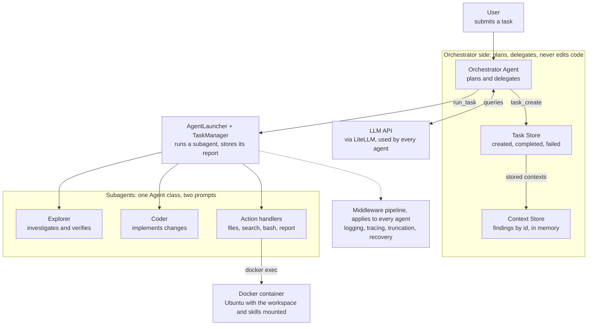
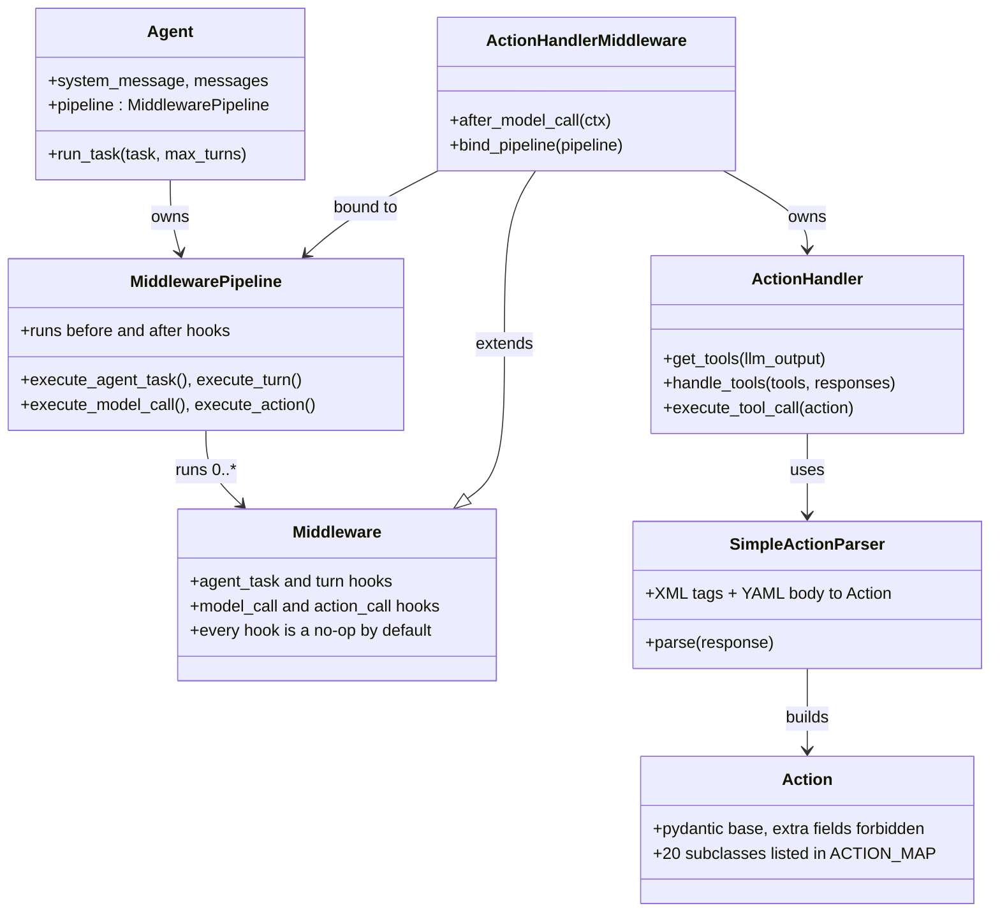
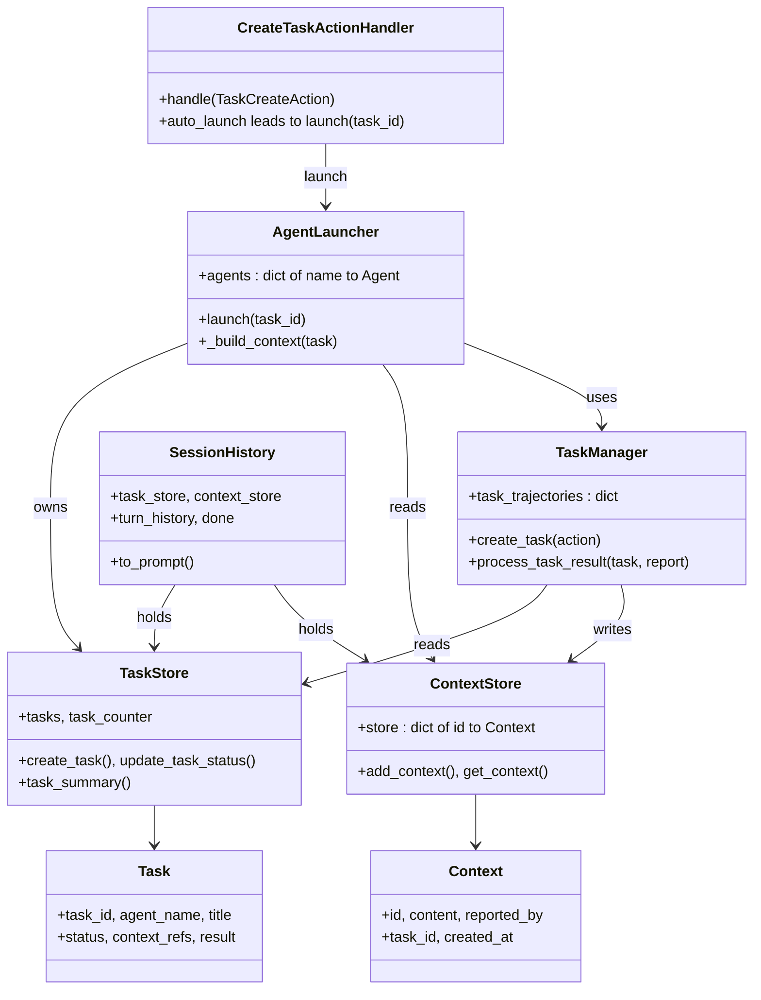
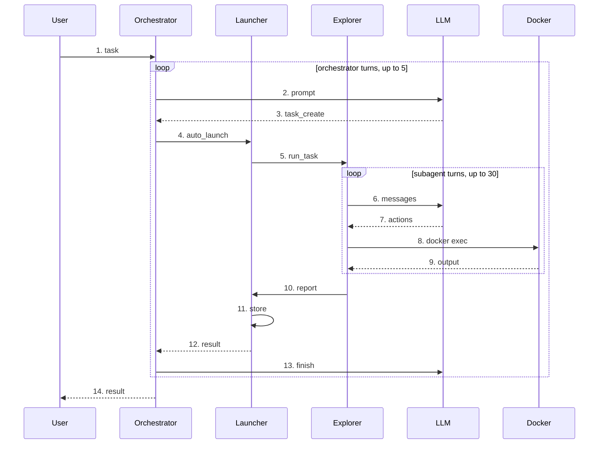

# Course: AI Code Assistant (ai-code-assistent) design and code

## 1. Course overview

This course reads apssouza22/ai-code-assistent and teaches its design with the matching code placed right inside each design section.

The repo is an experimental coding assistant built on the Deep Agents idea: an **Orchestrator** that never touches code plans and delegates to an **Explorer** (investigates and verifies) and a **Coder** (edits files), while a **Context Store** and a **Task Store** carry knowledge and progress between them.

**Who it is for.** Engineers who use Cursor, Claude Code or Codex and want to see how that layer is built in plain Python. You should read Python and know what an LLM chat call looks like.

**Learning objectives.** After this course you can:

- trace one user task through orchestrator, explorer and coder
- explain the middleware pipeline and the four lifecycle levels it wraps (task, turn, model call, action)
- explain how the model's text becomes a validated action and then a Docker command
- explain how shared state (contexts and tasks) is written, read and shown back to the model
- name the gaps in the sample, such as where read-only enforcement really lives

**How to read it.** Design and code live together. Each design section is followed by *cards*: a short excerpt from the repo with its file link, then **What it does** and **Hard part**. Links point to the `main` branch of [apssouza22/ai-code-assistent](https://github.com/apssouza22/ai-code-assistent).

**Course map.**

| Section | Design content | Code cards |
| --- | --- | --- |
| 2. Requirements | What the system must do, mapped to files | none, links only |
| 3. Non-functional requirements | Qualities met and missing | retry with backoff, output truncation |
| 4. High-level components | Component diagram | wiring, agent loop, LLM client, executor, stores |
| 5. Class diagrams | Execution core, and delegation and state | actions, parser, dispatch, pipeline, tasks, reports |
| 6. Sequence | One task end to end | prompt, delegation, subagent turn, report, finish |
| 7. Gaps and exercises | Findings, practice, self-check | none |

**Stack.** Python, LiteLLM for model calls, pydantic for action validation, YAML for parsing action bodies, and Docker as the sandbox for file and shell actions.

## 2. Requirements

The repo has no formal requirements file; these are read from the README and the code. Each row names where the code meets it, and sections 4 to 6 show that code.

| ID | Requirement | Where it is met |
| --- | --- | --- |
| FR-1 | Take a task from a CLI option, a file, standard input or an interactive prompt | `main.py` `read_task_instruction` |
| FR-2 | An orchestrator plans and delegates, but has no file or shell actions | Orchestrator action table in `main.py` |
| FR-3 | Create tracked tasks for an explorer or a coder, with title, description, context references and optional auto-launch | `TaskCreateAction`, `TaskStore.create_task` |
| FR-4 | Run a subagent on a task until it reports, and return the report | `AgentLauncher.launch` |
| FR-5 | Subagents report findings as contexts that are stored by id and reused by later tasks | `ReportAction`, `TaskManager.process_task_result`, `ContextStore` |
| FR-6 | Show the orchestrator the task list, the stored context ids and the turn history on every turn | `SessionHistory.to_prompt` |
| FR-7 | Turn the model's text into validated actions, and send parse errors back to the model | `SimpleActionParser`, `ActionHandler.get_tools` |
| FR-8 | Run file, search and shell actions inside a sandbox | `DockerExecutor`, `bash_handlers.py`, `file_handlers.py` |
| FR-9 | End a run on finish (orchestrator), report (subagent) or a turn limit | `Agent._handle_task` |
| FR-10 | Add logging, tracing, truncation and error handling without editing the agent loop | `MiddlewarePipeline` and the `ext` middlewares |
| FR-11 | Inject available skills and MCP tools into prompts | `AgentSkillsMiddleware`, `AgentMcpMiddleware` |
| FR-12 | Write a structured trace of each turn | `TracingMiddleware`, `TurnLogger` |
| FR-13 | Call different models through one client | `get_llm_response` (LiteLLM) |

**Typical flow (from the README).** The user asks for a change; the orchestrator launches an explorer to find existing patterns; the explorer reports findings into the context store; the orchestrator launches a coder with those contexts; the coder reports what it changed; the orchestrator launches an explorer again to verify, then finishes.

## 3. Non-functional requirements

The sample is built for clarity, so extensibility and observability are strong, while isolation of roles, error recovery and persistence are weaker than the README suggests.

| Quality | Target | What the repo does | Gap |
| --- | --- | --- | --- |
| Isolation | File and shell actions cannot touch the host | They run through `docker exec` in an Ubuntu container with a mounted workspace | The container is started per run and nothing in the files read stops it; paths are placed inside shell strings |
| Role safety | Explorer is read-only, orchestrator has no code access | The orchestrator's action table has no file or shell actions | Explorer and coder receive the same action table, so "read-only" rests on the system prompt alone |
| Reliability | A failed call must not end the run | Parse errors go back to the model; overloaded-model errors are retried | `ErrorRecoveryMiddleware` records an error result but leaves the exception set, so `Agent` still re-raises it |
| Bounded cost | Limit turns, tokens and output | Turn limits per agent; output truncation; Anthropic prompt caching; turn history capped at 100 | The orchestrator's message list grows on every turn (section 6, card 6.1) |
| Observability | See every turn | `LoggingMiddleware` and per-turn trace files from `TracingMiddleware` | Logs are files and console output only, with no metrics |
| Extensibility | Add behaviour without editing the loop | New middleware overrides only the hooks it needs; new action = model class + map entry + handler | The action map and `main.py` wiring are edited by hand |
| Persistence | Knowledge outlives a run | The README calls the Context Store persistent | Both stores are in-memory dictionaries that live for one run |
| Testability | Run without Docker | `CommandExecutor` is an abstract class, so a fake executor can replace Docker | Subagents run one after another, so tests that need concurrency are not covered |

#### Card N1: Retry with exponential backoff

Source: [`src/core/llm/llm_client.py`](https://github.com/apssouza22/ai-code-assistent/blob/main/src/core/llm/llm_client.py)

```python
        except InternalServerError as e:
            if "overloaded_error" in str(e):
                if attempt < max_retries - 1:
                    base_delay = 2 ** attempt
                    jitter = random.uniform(0, base_delay * 0.1)
                    delay = min(base_delay + jitter, 60)
                    ...
                    time.sleep(delay)
                else:
                    raise
            else:
                raise
```

**What it does.** When the provider says it is overloaded, the client waits and tries again, doubling the wait each time up to 60 seconds, for at most 10 attempts.

**Hard part.** Only one error type, and only when its text contains `overloaded_error`, is retried; every other error is re-raised at once. The random jitter (up to 10% of the delay) stops many clients from retrying at the same instant. In the worst case the waits add up to roughly four minutes before the final attempt, during which the whole assistant is blocked.

#### Card N2: Output truncation as a middleware

Source: [`src/ext/output_truncation.py`](https://github.com/apssouza22/ai-code-assistent/blob/main/src/ext/output_truncation.py) and [`src/main.py`](https://github.com/apssouza22/ai-code-assistent/blob/main/src/main.py)

```python
    def after_action_call(self, ctx: ActionCallContext) -> ActionCallContext:
        if ctx.output and len(ctx.output) > self._max_chars:
            total = len(ctx.output)
            removed = total - self._max_chars
            ctx.output = ctx.output[: self._max_chars] + self.TRUNCATION_NOTICE.format(
                removed=removed, total=total
            )
        return ctx
```

```python
ACTION_OUTPUT_MAX_CHARS = 1_000
...
        ActionOutputTruncationMiddleware(max_chars=ACTION_OUTPUT_MAX_CHARS),
```

**What it does.** After each action runs, an oversized output is cut to the limit and a notice says how many characters were removed, so the model knows it saw only part.

**Hard part.** The class default is 30,000 characters, but `main.py` passes 1,000 for subagents, so a single file read is cut very quickly and the model must page through files with the `offset` and `limit` options of `ReadAction`. The orchestrator has no truncation middleware, so its action outputs are never cut.

## 4. High-level components


*Highlighted in the original: the Orchestrator. Dashed: the middleware pipeline applies to every agent.*

The orchestrator's only actions create tasks, add context, report, finish and call MCP tools, so it can plan but never reads or writes files. A task is run by the launcher, which hands it to a subagent. Subagents get the file, search and shell handlers, and those run inside a Docker container. The cards below show the code behind each box.

#### Card 4.1: The composition root decides each agent's powers

Source: [`src/main.py`](https://github.com/apssouza22/ai-code-assistent/blob/main/src/main.py)

```python
    actions = {
        TaskCreateAction: create_task_handler.handle,
        ReportAction: ReportActionHandler().handle,
        AddContextAction: AddContextActionHandler(context_store).handle,
        FinishAction: FinishActionHandler().handle,
        McpAction: McpActionHandler(agent_mcp_middleware.client).handle,
    }
    orchestrator_agent = Agent(
        agent_name="orchestrator",
        system_prompt=load_orchestrator_system_message(),
        actions=actions,
        llm_config=llm_config,
        ...
    )
```

```python
    actions = files_actions | bash_actions | other_actions | mcp_actions
    ...
    subagents = {
        "explorer": Agent(..., actions=actions, ...),
        "coder": Agent(..., actions=actions, ...),
    }
```

**What it does.** `main.py` builds every object and connects them. An agent's `actions` is a dictionary from an action class to the function that handles it, so the dictionary is the list of things that agent is able to do.

**Hard part.** The action table is the real permission system. The orchestrator's table has no file or shell entries, so it cannot touch code, and that is enforced by code. Explorer and coder, however, are given the same `actions` object, so "explorer is read-only" is only an instruction in its system prompt. Also note the orchestrator is run with `max_turns=5`, while the `Agent` default is 30.

#### Card 4.2: The agent loop holds no LLM or tool code

Source: [`src/core/agent/agent.py`](https://github.com/apssouza22/ai-code-assistent/blob/main/src/core/agent/agent.py)

```python
        for turn_num in range(self.max_turns):
            turn_ctx.turn_num = turn_num + 1
            turn_ctx =  self.pipeline.execute_turn(turn_ctx, self._turn)

            if turn_ctx.turn_exception:
                raise turn_ctx.turn_exception
            ...
            if turn_ctx.report:
                agent_ctx.task_result = turn_ctx.report
                return agent_ctx

        agent_ctx.task_result = AgentReport("Reached max turns. Task not completed.")
```

```python
    def _turn(self, turn_ctx: TurnContext) -> TurnContext:
        model_call_ctx = self.pipeline.execute_model_call(turn_ctx.messages, self._get_llm_inference, self.agent_name)
        turn_ctx.llm_response = model_call_ctx.response
        turn_ctx.result = model_call_ctx.execution_result
        return turn_ctx
```

**What it does.** `Agent` repeats turns up to a limit. Each turn runs through the pipeline, which makes one model call and executes the resulting actions. The loop ends when a turn produces a `report`, or after the last allowed turn.

**Hard part.** Nothing in `Agent` decides that the task is finished: a middleware sets `turn_ctx.report` after it sees a finish or report action (cards 6.4 and 6.5). The exception check sits right after the pipeline, which matters for `ErrorRecoveryMiddleware`: it fills in an error result but does not clear `turn_exception`, so this line still raises (see section 7).

#### Card 4.3: One LLM call, text in and text out

Source: [`src/core/llm/llm_client.py`](https://github.com/apssouza22/ai-code-assistent/blob/main/src/core/llm/llm_client.py)

```python
    processed_messages = _apply_anthropic_caching_if_possible(messages, model)
    ...
            is_reasoning_model = "gpt-5" in model
            token_params = {"max_completion_tokens": max_tokens} if is_reasoning_model else {"max_tokens": max_tokens}
            response = litellm.completion(
                model=model,
                messages=processed_messages,
                temperature=temperature,
                reasoning_effort="low" if is_reasoning_model else None,
                **token_params
            )
            return response.choices[0].message.content
```

**What it does.** It sends the message list through LiteLLM and returns the reply text. For Anthropic models it first marks the system message and the last two user messages as cacheable.

**Hard part.** The function returns a plain string, not tool calls: this assistant does not use the provider's function-calling feature. The model must write actions as text, and the parser (card 5.2) reads them back. Model quirks are handled by name checks: a model with `gpt-5` in its name gets `max_completion_tokens` and a low reasoning effort, and caching is applied only when the name contains `anthropic/`.

#### Card 4.4: Handlers talk to an executor, not to Docker

Source: [`src/core/backend/command_env_executor.py`](https://github.com/apssouza22/ai-code-assistent/blob/main/src/core/backend/command_env_executor.py) and [`src/core/bash/bash_handlers.py`](https://github.com/apssouza22/ai-code-assistent/blob/main/src/core/bash/bash_handlers.py)

```python
            proc = subprocess.Popen(
                ['docker', 'exec', self.container_name, 'bash', '-c', cmd],
                stdout=subprocess.PIPE,
                stderr=subprocess.STDOUT
            )
```

```python
            if action.block:
                output, exit_code = self.executor.execute(
                    action.cmd,
                    timeout=action.timeout_secs
                )
            else:
                self.executor.execute_background(action.cmd)
                output = "Command started in background"
                exit_code = 0

            is_error = exit_code != 0
            return format_tool_output("bash", output), is_error
```

**What it does.** `DockerExecutor` runs a command with `docker exec` and returns the output and exit code. `BashActionHandler` calls the abstract `CommandExecutor`, runs blocking or background commands, and marks a non-zero exit code as an error.

**Hard part.** Because handlers depend only on the abstract class, Docker can be replaced by a fake executor in tests. Standard error is merged into standard output, so the model cannot tell the two apart. On a timeout the code kills the local `docker exec` process and returns exit code 124; the files read do not show whether the command inside the container is also stopped.

#### Card 4.5: The Context Store is an id-keyed dictionary

Source: [`src/core/context/context.py`](https://github.com/apssouza22/ai-code-assistent/blob/main/src/core/context/context.py), [`src/core/context/context_store.py`](https://github.com/apssouza22/ai-code-assistent/blob/main/src/core/context/context_store.py) and [`src/core/context/context_handler.py`](https://github.com/apssouza22/ai-code-assistent/blob/main/src/core/context/context_handler.py)

```python
@dataclass
class Context:
    id: str
    content: str
    reported_by: str
    task_id: Optional[str] = None
    created_at: str = field(default_factory=lambda: datetime.now().isoformat())
```

```python
            if self.context_store.get_context(action.id):
                pretty_log.warning(f"Context {action.id} already exists")
                response = f"[WARNING] Context '{action.id}' already exists in store"
                return format_tool_output("context", response), True
```

**What it does.** A context is a named piece of knowledge: an id, the text, who reported it and which task it came from. The store keeps them in a dictionary, and the add-context handler refuses an id that already exists.

**Hard part.** Adding is not overwriting: if an agent wants to correct a finding it must use a new id. The store lives in memory for one run, so despite the README's word "persistent" nothing survives the process. `reported_by` is a free label; when `TaskManager` stores a subagent's report it fills it with the task id.

#### Card 4.6: The Task Store gives the model ids to refer to

Source: [`src/core/task/task.py`](https://github.com/apssouza22/ai-code-assistent/blob/main/src/core/task/task.py) and [`src/core/task/task_store.py`](https://github.com/apssouza22/ai-code-assistent/blob/main/src/core/task/task_store.py)

```python
class TaskStatus(Enum):
    CREATED = "created"
    COMPLETED = "completed"
    FAILED = "failed"
```

```python
        self.task_counter += 1
        task_id = f"task_{self.task_counter:03d}"
```

**What it does.** Every task gets a readable id such as `task_001` and a status. `task_summary()` turns the whole store into text that is shown to the orchestrator on every turn.

**Hard part.** The counter-based id is what lets the model say "launch `task_002`" or pass contexts between tasks. `FAILED` exists in the enum, but none of the files read sets it; a task moves from `CREATED` to `COMPLETED` only when its report is processed. That gap is a good exercise (section 7).

## 5. Class diagrams

The system is easier to read as two class groups: the execution core (how one agent turn runs) and delegation and state (how tasks and contexts move between agents).

#### 5a. Execution core


*Highlighted in the original: MiddlewarePipeline, the hub every agent runs through.*

`Agent` owns a `MiddlewarePipeline` and appends one `ActionHandlerMiddleware` to the middlewares it is given. That middleware extends `Middleware`, is bound back to the pipeline, and owns an `ActionHandler`, which uses the parser to build `Action` objects from model text. The four context dataclasses (`AgentTaskContext`, `TurnContext`, `ModelCallContext`, `ActionCallContext`) and `ExecutionResult` carry state between hooks and are not drawn.

#### Card 5.1: Actions are pydantic models

Source: [`src/core/action/actions.py`](https://github.com/apssouza22/ai-code-assistent/blob/main/src/core/action/actions.py) and [`src/core/action/action_maps.py`](https://github.com/apssouza22/ai-code-assistent/blob/main/src/core/action/action_maps.py)

```python
class Action(BaseModel):
    model_config = {"extra": "forbid", "validate_assignment": True}

class BashAction(Action):
    cmd: str = Field(min_length=1)
    block: bool = True
    timeout_secs: int = Field(default=30, gt=0, le=300)

class TaskCreateAction(Action):
    agent_name: Literal["explorer", "coder"]
    title: str = Field(min_length=1)
    description: str = Field(min_length=1)
    context_refs: List[str] = []
    context_bootstrap: List[dict] = []
    auto_launch: bool = False
```

```python
ACTION_MAP: Dict[str, Type[Action]] = {
    "bash": BashAction,
    "finish": FinishAction,
    ...
    "task_create": TaskCreateAction,
```

**What it does.** Each thing the model may ask for is a class whose fields are the arguments. `ACTION_MAP` links the tag name the model writes (`bash`, `task_create`, ...) to the class that validates it.

**Hard part.** These classes play the role that JSON tool schemas play in a function-calling API. Rules such as `timeout_secs` at most 300, or `agent_name` being exactly `explorer` or `coder`, are checked when the model's text is parsed, and a violation becomes an error message sent back to the model. `extra: forbid` turns any invented field into an error too. Note the default `auto_launch=False`: creating a task does not run it.

#### Card 5.2: From model text to an Action

Source: [`src/core/action/parser.py`](https://github.com/apssouza22/ai-code-assistent/blob/main/src/core/action/parser.py)

```python
IGNORED_TAGS = {"think", "reasoning", "plan_md"}
...
        pattern = r'(?:^|\n)\s*<(\w+)>([\s\S]*?)</\1>'
        return re.findall(pattern, response, re.MULTILINE)
```

```python
            try:
                data = yaml.safe_load(content.strip())
            except yaml.YAMLError as e:
                errors.append(f"YAML parse error in <{tag_name}>: {e}")
                continue
            ...
                action = action_class.model_validate(data)
```

An illustrative reply the parser accepts (written for this course, not taken from the repo):

```
<think>I need to list the files first.</think>
<bash>
cmd: ls -la
timeout_secs: 10
</bash>
```

**What it does.** It finds XML-style tags in the reply, reads each tag's body as YAML, looks the tag up in `ACTION_MAP`, and validates the data into an action. Problems are collected as error strings instead of raised.

**Hard part.** The regular expression requires a tag to start a line, so tags in the middle of a sentence are ignored. The tags `think`, `reasoning` and `plan_md` are skipped on purpose, which lets the model reason in tags without those being treated as actions. YAML is the argument syntax, so a multi-line string needs a block scalar (`|`), which is why the handler's error text keeps repeating that advice.

#### Card 5.3: Dispatch by exact class, and errors as feedback

Source: [`src/core/action/action_handler.py`](https://github.com/apssouza22/ai-code-assistent/blob/main/src/core/action/action_handler.py)

```python
        if parsing_errors:
            has_error = True
            for error in parsing_errors:
                env_responses.append(
                    f"[PARSE ERROR] {error} \n USE BLOCK SCALARS (|) TO FIX MULTILINE STRINGS ISSUES!"
                )
```

```python
    def execute_tool_call(self, action: Action) -> Tuple[str, bool]:
        handler = self._actions.get(type(action))
        if handler:
            return handler(action)
        class_name = type(action).__name__
        return format_tool_output("unknown", f"[ERROR] Unknown action type: {class_name}"), True
```

**What it does.** Parse errors become `[PARSE ERROR]` lines that go back to the model on the next turn. To run an action, the handler looks up `type(action)` in the agent's own action dictionary and calls the function it finds.

**Hard part.** The parser knows all 20 action tags, but each agent's dictionary holds only some of them. If the orchestrator writes a `<bash>` tag, parsing succeeds and then dispatch fails with "Unknown action type". That is the runtime check behind "the orchestrator cannot touch code". The lookup uses the exact class, so a subclass of a registered action would not match.

#### Card 5.4: Middleware is hooks over a shared context

Source: [`src/core/middleware/base.py`](https://github.com/apssouza22/ai-code-assistent/blob/main/src/core/middleware/base.py)

```python
@dataclass
class ModelCallContext:
    messages: List[Dict[str, Any]]
    agent_name: str = ""
    response: Optional[str] = None
    skipped: bool = False
    execution_result: Optional[ExecutionResult] = None
    metadata: Dict[str, Any] = field(default_factory=dict)
```

```python
class Middleware:
    def before_turn(self, ctx: TurnContext) -> TurnContext:
        """Called before each turn. Set ``ctx.aborted = True`` to skip the turn."""
        return ctx

    def after_model_call(self, ctx: ModelCallContext) -> ModelCallContext:
        """Called after each LLM call completes."""
        return ctx
```

**What it does.** One `Middleware` class has a `before_` and an `after_` hook at four levels: agent task, turn, model call and action call. Each hook receives a context object, changes it and returns it. A subclass overrides only the hooks it needs.

**Hard part.** Hooks do not call a `next` function as in web frameworks. They communicate by setting fields: `aborted` or `skipped` tells the pipeline to stop, and `metadata` is a free dictionary for passing data between middlewares. `TracingMiddleware` treats metadata keys that start with an underscore as private and leaves them out of the trace.

#### Card 5.5: The pipeline runs hooks, but not as an onion

Source: [`src/core/middleware/pipeline.py`](https://github.com/apssouza22/ai-code-assistent/blob/main/src/core/middleware/pipeline.py)

```python
        called = []
        for mw in self._middlewares:
            ctx = mw.before_turn(ctx)
            if ctx.aborted:
                for after_mw in called:
                    ctx = after_mw.after_turn(ctx)
                return ctx
            called.append(mw)

        try:
            ctx:TurnContext = turn_fn(ctx)
        except Exception as exc:
            ctx.turn_exception = exc

        for mw in called:
            ctx = mw.after_turn(ctx)
```

**What it does.** For a turn it runs every `before_turn`, then the turn itself, then the `after_turn` of each middleware whose `before_turn` ran. The same shape is repeated for the task, model-call and action levels.

**Hard part.** The `after_` hooks run in the same order as the `before_` hooks, not in reverse, so this is not the nested "onion" model; list order therefore matters when one `after_` hook depends on another. An exception from the turn is caught and stored in `ctx.turn_exception`, so the `after_` hooks can still see it. If a `before_` hook aborts, only the middlewares already called get their `after_`.

#### Card 5.6: Tool execution is a middleware too

Source: [`src/core/agent/agent.py`](https://github.com/apssouza22/ai-code-assistent/blob/main/src/core/agent/agent.py) and [`src/core/action/action_handler_middleware.py`](https://github.com/apssouza22/ai-code-assistent/blob/main/src/core/action/action_handler_middleware.py)

```python
        merged_middlewares = [*list(middlewares or []), action_handler_middleware]
        self.pipeline = MiddlewarePipeline(merged_middlewares)
        action_handler_middleware.bind_pipeline(self.pipeline)
```

```python
                output, action_error = pipeline.execute_action(
                    tool,
                    self._tool_handler.execute_tool_call,
                    agent_name,
                )
                ...
                if isinstance(tool, FinishAction):
                    finish_message = tool.message
                    done = True
                    break
```

**What it does.** The agent adds `ActionHandlerMiddleware` as the last middleware. In its `after_model_call` hook it parses the reply and runs each action through `pipeline.execute_action`, so action-level hooks (logging, truncation) wrap every tool call.

**Hard part.** The middleware is created before the pipeline that contains it, so the pipeline is handed back afterwards with `bind_pipeline`. Because it is last, its `after_model_call` runs after the model-call hooks of any other middleware, which is why it can see their changes to the context. A `FinishAction` ends the loop over actions at once, so any actions written after it in the same reply are dropped.

#### 5b. Delegation and state


*Highlighted in the original: AgentLauncher, which starts every subagent. Not drawn: Turn, TurnHistory, SubagentReport.*

When a task is created, `CreateTaskActionHandler` asks `TaskManager` for the task and, if `auto_launch` is set, calls `AgentLauncher`. The launcher gets the task from the manager, reads the contexts it references, runs the subagent, and passes the report back to the manager, which writes new contexts into `ContextStore` and marks the task complete. `SessionHistory` reads both stores to build the orchestrator's prompt (the `ContextStore` link is not drawn).

#### Card 5.7: Creating a task, and the auto_launch switch

Source: [`src/core/task/create_task_handler.py`](https://github.com/apssouza22/ai-code-assistent/blob/main/src/core/task/create_task_handler.py)

```python
            task = self.task_manager.create_task(action)
            response = f"Created task {task.task_id}: {action.title}"
            if action.auto_launch:
                launch_response, launch_error = self.agent_launcher.launch(task.task_id)
                response += f"\n{launch_response}"
                return format_tool_output("task", response), launch_error

            return format_tool_output("task", response), False
```

**What it does.** The handler stores the task, and when `auto_launch` is true it immediately runs the subagent and appends the launch result to the answer the orchestrator sees.

**Hard part.** In `main.py` the orchestrator's action table has `TaskCreateAction` but not `LaunchSubagentAction`, although a separate launch action and handler class exist. With this wiring, `auto_launch: true` is the only way an orchestrator task ever runs. The launch is synchronous: the orchestrator's turn is blocked until the subagent finishes or runs out of turns.

#### Card 5.8: The launcher builds the briefing and runs the agent

Source: [`src/core/task/subagent_luncher.py`](https://github.com/apssouza22/ai-code-assistent/blob/main/src/core/task/subagent_luncher.py) (the file name is spelled this way in the repo)

```python
        agent_task = self._get_agent_task(task)
        subagent_result = agent.run_task(agent_task)

        result = self.task_manager.process_task_result(task, subagent_result.metadata.get("subagent_report"))
```

```python
        task_context = self._get_context_by_ids(task.context_refs)
        file_context = []
        if not task.context_bootstrap:
            return file_context, task_context

        # TODO: implement the file search and retrieval logic here, for now we just log the intention
```

**What it does.** The launcher finds the task and its agent by name, builds a `SubagentTask` whose context is the text of every referenced context id, runs the agent to completion, and hands the report to the manager.

**Hard part.** Two details. First, `context_bootstrap` (a list of files and reasons) is accepted, validated and stored, but the TODO shows the files are never loaded, so only context ids actually reach the subagent. Second, `subagent_result.metadata.get(...)` assumes the run ended with a report; when a subagent runs out of turns, its `AgentReport` has no metadata (it is `None`), so this call would raise an error instead of recording a failed task.

#### Card 5.9: Storing what a subagent reported

Source: [`src/core/task/task_manager.py`](https://github.com/apssouza22/ai-code-assistent/blob/main/src/core/task/task_manager.py)

```python
        for ctx in report.contexts:
            if ctx.id and ctx.content:
                self._add_context(
                    context_id=ctx.id,
                    content=ctx.content,
                    reported_by=task.task_id,
                    task_id=task.task_id
                )
                stored_context_ids.append(ctx.id)
```

```python
        task.result = result
        self.task_store.update_task_status(task.task_id, TaskStatus.COMPLETED)
```

**What it does.** Each reported context with an id and content is written to the Context Store, tagged with the task that produced it, and the task is marked completed with a summary of what was stored.

**Hard part.** `_add_context` returns `False` and skips the write when the id already exists, but its return value is ignored and the id is added to `stored_context_ids` anyway. The summary the orchestrator reads can therefore list an id whose new content was discarded. Also, the task becomes `COMPLETED` whatever the report contained.

#### Card 5.10: What the orchestrator sees each turn

Source: [`src/core/orchestrator/session_history.py`](https://github.com/apssouza22/ai-code-assistent/blob/main/src/core/orchestrator/session_history.py) and [`src/core/orchestrator/turn_history.py`](https://github.com/apssouza22/ai-code-assistent/blob/main/src/core/orchestrator/turn_history.py)

```python
        sections.append("## Task Manager State\n")
        sections.append(self.task_store.task_summary())
        sections.append("\n## Available Context IDs\n")
        sections.append(self._get_context_index())

        sections.append("\n## Conversation History\n")
        sections.append(self.turn_history.to_prompt())
```

```python
    max_turns: int = 100  # Keep last N turns to avoid context explosion
```

**What it does.** `to_prompt` builds the state block shown to the orchestrator: the task list, an index of context ids with who reported them, and the earlier turns. `TurnHistory` keeps only the last 100 turns, and each turn's model output is cut to 500 characters in the prompt.

**Hard part.** The context index lists ids and authors, not content. None of the 20 actions in `ACTION_MAP` reads a stored context back, so the orchestrator learns what subagents found only from their comments and from the ids it passes on in `context_refs`. The design relies on ids as handles: knowledge flows between subagents without the orchestrator reading it.

## 6. Sequence


*Lifeline "Launcher" stands for the task handler, the launcher and the task manager together.*

The Launcher lifeline stands for the task handler, the launcher and the task manager together. The README flow repeats steps 2 to 12 three times: an explorer investigates, a coder implements, and an explorer verifies. Returns to the LLM are not drawn; the model's reply is the dashed arrow back. In step 13 the orchestrator finally replies with a finish action. The cards follow the order of the messages.

#### Card 6.1: Step 2, the orchestrator prompt grows every turn

Source: [`src/core/orchestrator/orchestrator_session_prompt_middleware.py`](https://github.com/apssouza22/ai-code-assistent/blob/main/src/core/orchestrator/orchestrator_session_prompt_middleware.py)

```python
    def before_turn(self, ctx: TurnContext) -> TurnContext:
        agent_prompt = f"## Current Task\n{ctx.prompt}\n\n{self._session_history.to_prompt()}"
        ctx.messages.append({"role": "system", "content": self._system_message + self._skill_prompt + self._mcp_prompt})
        ctx.messages.append({"role": "user", "content": agent_prompt})
        return ctx
```

**What it does.** Before each orchestrator turn it builds a user message with the current task and the full session state (card 5.10), and adds it together with the system prompt, skills and MCP tool text.

**Hard part.** It appends to `ctx.messages` and never replaces it, and the orchestrator has no middleware that clears the list. So every turn adds another system message and another user message that repeats the whole state, and the model receives all the earlier copies as well. With five turns that is small, but prompt size grows faster than the number of turns, which also explains why the state block is the place to keep an eye on cost.

#### Card 6.2: Step 5, a subagent starts from a clean briefing

Source: [`src/ext/subagent_task_bootstrap.py`](https://github.com/apssouza22/ai-code-assistent/blob/main/src/ext/subagent_task_bootstrap.py) and [`src/core/agent/subagent_task.py`](https://github.com/apssouza22/ai-code-assistent/blob/main/src/core/agent/subagent_task.py)

```python
        ctx.messages[:] = [
            {"role": "system", "content": ctx.system_message},
            {"role": "user", "content": build_subagent_task_prompt(ctx.task)},
        ]
```

```python
    sections = [f"# Task: {task.title}\n", f"{task.description}\n"]
    if task.task_context:
        sections.append("## Provided Context\n")
        for ctx_id, content in task.task_context.items():
            sections.append(f"### Context: {ctx_id}\n")
            sections.append(f"{content}\n")
```

**What it does.** Before a subagent task runs, its message list is reset to two messages: the subagent's system prompt and a briefing built from the task title, description and the text of each referenced context.

**Hard part.** This is context isolation. The subagent never sees the orchestrator's conversation, only this briefing, so anything it needs must be written into the task description or passed as a context id. The slice assignment `messages[:] = ...` changes the same list object the `Agent` holds, which is how a reused agent object starts each task fresh. The middleware does nothing unless the task is a `SubagentTask`.

#### Card 6.3: Steps 6 to 9, observations come back as a user message

Source: [`src/ext/subagent_turn_completion.py`](https://github.com/apssouza22/ai-code-assistent/blob/main/src/ext/subagent_turn_completion.py)

```python
        outputs = "\n".join(ctx.result.actions_outputs)
        ...
        ctx.messages.append({"role": "assistant", "content": ctx.llm_response})
        ctx.messages.append({"role": "user", "content": outputs})
```

**What it does.** After each subagent turn, the model's reply is appended as an assistant message and the joined action outputs are appended as a user message. The next model call therefore sees the action results as the observation.

**Hard part.** This is the ReAct loop in message form: reasoning and actions in the assistant message, the observation in the next user message. There is no separate tool-result role because the model's actions are plain text. The same file adds an "Error occurred ... Please continue." message when `turn_error` is set, but because `Agent` raises the stored exception right after the pipeline (card 4.2), that message is followed by a raise rather than another turn.

#### Card 6.4: Steps 10 and 11, reporting is what ends a subagent

Source: [`src/ext/subagent_report.py`](https://github.com/apssouza22/ai-code-assistent/blob/main/src/ext/subagent_report.py) and [`src/core/action/handlers/report_handler.py`](https://github.com/apssouza22/ai-code-assistent/blob/main/src/core/action/handlers/report_handler.py)

```python
        for action in ctx.result.actions_executed:
            if isinstance(action, ReportAction):
                contexts = [ContextItem(id=ctxs["id"], content=ctxs["content"]) for ctxs in action.contexts]
                ctx.report = AgentReport(
                    "Subagent task completed.",
                    metadata={"subagent_report": SubagentReport(
                        contexts=contexts,
                        comments=action.comments,
                    )}
                )
```

```python
class ReportActionHandler(ActionHandlerInterface):
    def handle(self, action: ReportAction) -> Tuple[str, bool]:
        return format_tool_output("report", "Report submission successful"), False
```

**What it does.** The `report` action's own handler only answers "Report submission successful". The real work is in the middleware: after the turn it turns the action's contexts and comments into a `SubagentReport` and sets `ctx.report`, which is the signal the agent loop stops on (card 4.2). The launcher then reads that report from the metadata (card 5.8).

**Hard part.** `ReportAction.contexts` is a plain list of dictionaries, so the line `ctxs["id"]` raises a `KeyError` if the model forgets the `id` or `content` key, and this happens inside an `after_turn` hook, after the action already reported success.

#### Card 6.5: Step 13, the orchestrator finishes with a finish action

Source: [`src/core/orchestrator/orchestrator_session_history_middleware.py`](https://github.com/apssouza22/ai-code-assistent/blob/main/src/core/orchestrator/orchestrator_session_history_middleware.py)

```python
        turn = Turn(
            llm_output=ctx.llm_response,
            actions_executed=result.actions_executed,
            action_outputs=result.actions_outputs,
            task_trajectories=result.task_trajectories,
        )
        self._session_history.turn_history.add_turn(turn)
        self._session_history.done = result.done
        ...
        if result.done:
            ...
            ctx.report = AgentReport("Orchestrator task completed.", metadata=report)
```

**What it does.** After each orchestrator turn it records the turn in `TurnHistory` (which feeds the next prompt, card 5.10) and copies `done` and the finish message into the session state. When a `finish` action was executed, it builds the final report, and that ends the loop.

**Hard part.** The two kinds of agent keep memory differently: subagents keep a chat transcript (card 6.3), while the orchestrator keeps structured state that is rebuilt into a fresh prompt each turn. If the orchestrator never sends `finish` within its 5 turns, `Agent` returns "Reached max turns. Task not completed." and the work done so far stays in the stores but is not summarised.

## 7. Gaps, exercises and self-check

**Gaps found while reading.** Each can be checked in the file named in the table; the card column says where it is explained.

| # | Where | Issue | Card |
| --- | --- | --- | --- |
| 1 | `ext/error_recovery.py`, `agent/agent.py` | The recovery middleware sets an error result but leaves `turn_exception` set, so `Agent` still raises it | 4.2, 6.3 |
| 2 | `main.py` | Explorer and coder share one action table, so the explorer's read-only role is enforced only by its prompt | 4.1 |
| 3 | `orchestrator_session_prompt_middleware.py` | The orchestrator's message list grows by two messages every turn, each repeating the whole state | 6.1 |
| 4 | `task/subagent_luncher.py` | `metadata.get(...)` assumes a report exists; a subagent that runs out of turns has no metadata | 5.8 |
| 5 | `task/task_manager.py` | Ids are reported as stored even when a duplicate id was skipped | 5.9 |
| 6 | `task/subagent_luncher.py` | `context_bootstrap` files are accepted but never loaded (a TODO) | 5.8 |
| 7 | `task/task.py` | `TaskStatus.FAILED` exists, but none of the files read sets it | 4.6 |
| 8 | `main.py`, `README.md` | `main.py` sets the model to `openai/gpt-4.1-2025-04-14`, while the README says the default is `openai/gpt-5` | none |
| 9 | `main.py`, `core/task/subagent_handler.py` | A launch action and handler exist, but only `auto_launch` is wired for the orchestrator | 5.7 |
| 10 | stores, `main.py` | Both stores are in memory, and the Docker container started per run is not stopped in the files read | 4.5 |
| 11 | `core/agent`, `ext` | Two different files are named `subagent_report.py`, and one repeats another file's docstring | 6.4 |

**Exercises.**

1. Clear `turn_exception` in `ErrorRecoveryMiddleware` after it builds the error result, then write a test with a fake model function that raises, and check the agent takes another turn.
2. Change the orchestrator's prompt middleware to reset `ctx.messages` instead of appending, and compare token counts with `count_tokens_for_messages` over five turns.
3. Give the explorer an action table without write, edit and bash handlers, and check a coder task still works.
4. Implement `context_bootstrap`: read each listed path through the executor and fill `relevant_files`.
5. Guard the missing report in `AgentLauncher.launch` and set `TaskStatus.FAILED` when a subagent returns no report.
6. Make `_persist_contexts` return only the ids that were really added.
7. Add a `read_context` action so the orchestrator can read a stored context by id.
8. Write a middleware that stores per-turn token counts in `ctx.metadata` so `TracingMiddleware` logs them.

**Self-check.**

| Question | Answer |
| --- | --- |
| Why can the orchestrator not edit code? | Its action table has no file or shell handlers; a `bash` tag parses but dispatch answers "Unknown action type" |
| What ends a subagent run? | A middleware sets `ctx.report` after a `report` action, or the turn limit is reached |
| How does knowledge move between subagents? | Report contexts go through `TaskManager` into the Context Store; a later task lists them in `context_refs` and the launcher copies their text into its briefing |
| Why does middleware order matter? | `after_` hooks run in the same order as `before_` hooks, and `ActionHandlerMiddleware` is added last |
| Where is a tool's schema defined? | In a pydantic `Action` subclass plus its tag in `ACTION_MAP`; the assistant does not use provider function calling |
| What happens when the model writes a bad action? | A `[PARSE ERROR]` line goes back to the model on the next turn |
| How do the orchestrator and a subagent keep memory differently? | The orchestrator rebuilds a state prompt each turn; a subagent keeps a chat transcript |

## Licence note

The code excerpts come from [apssouza22/ai-code-assistent](https://github.com/apssouza22/ai-code-assistent), published under the Apache License 2.0 ([LICENSE](https://github.com/apssouza22/ai-code-assistent/blob/main/LICENSE)). If you reuse them in a lesson, keep the licence reference and any copyright notices, and say where you changed the code. The one block labelled "illustrative" in card 5.2 was written for this course.
