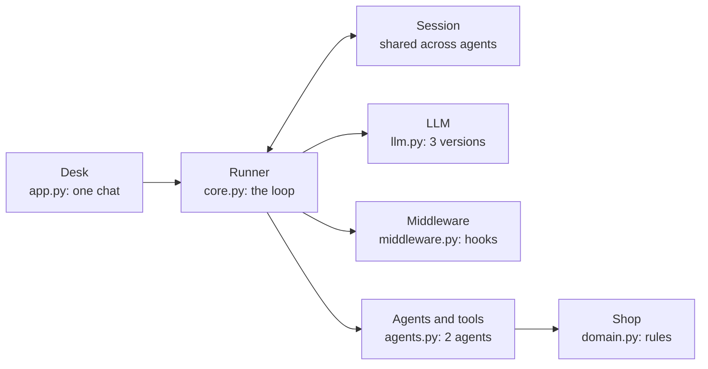
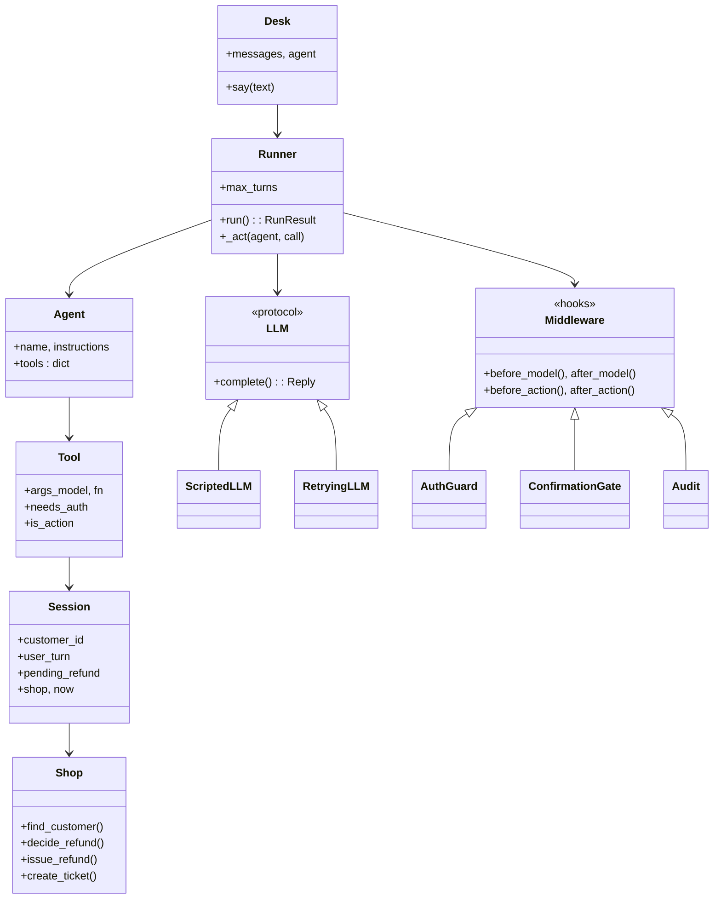
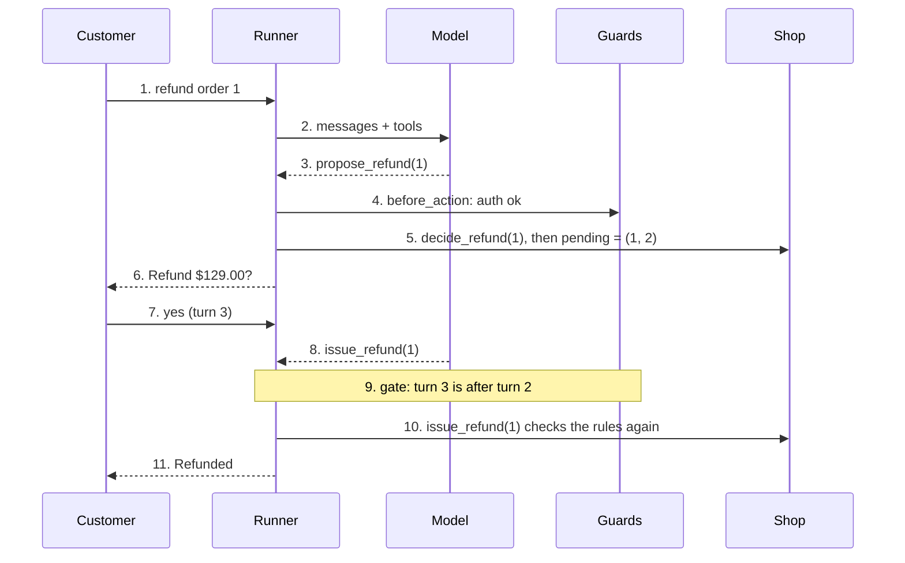

# Course: Comparing three agent codebases and building Refund Desk from the best parts

## 1. Course overview

This course compares ai-agent-react-llm, ai-code-assistent and the 03-ai-agents course code, then designs and implements one agent that keeps the best idea from each.

Three agent codebases solve similar problems in different ways, and this course compares them, then builds one small agent, Refund Desk, that keeps the best idea from each and fixes the bugs found in them.

**The three repos.**

| Short name | Repo | What it is |
| --- | --- | --- |
| R1 | [ai-agent-react-llm](https://github.com/apssouza22/ai-agent-react-llm) (branch `version-2`) | A ReAct agent in two versions, with an airline example that hands a conversation between agents |
| R2 | [ai-code-assistent](https://github.com/apssouza22/ai-code-assistent) | A coding assistant: an orchestrator that delegates to explorer and coder subagents |
| R3 | [03-ai-agents](https://github.com/mschwarzmueller/ai-agents-workflows-course/tree/main/code/03-ai-agents) | A five-step course: tool calls, a customer service agent, and a research pipeline |

**What gets built.** Refund Desk is a customer service agent for the shop domain of R3: a triage agent and a refunds agent. Business rules that R3 leaves to the prompt are enforced in code, handoff comes from R1, the middleware idea from R2, and the whole thing runs against a scripted model so its behaviour is tested without a network.

**Learning goals.** After this course you can:

- compare the three codebases on loop, tools, handoff, state, errors, safety and observability
- say which idea to take from each repo and which bug to avoid
- state the business rules of Refund Desk and show where code enforces each one
- read the implementation module by module and the tests that prove each rule

**How to read it.** Each design section is followed by *cards*: a code excerpt with its file name, then **What it does** and **Hard part**. Code for the three existing repos is described, not copied; the Refund Desk code is new and is shown in full detail.

| Section | Content |
| --- | --- |
| 2. Comparison | The three codebases side by side |
| 3. What to take | One idea per concern, and the bug to avoid |
| 4. Domain requirements | Use cases and business rules of Refund Desk |
| 5. Architecture | Component, class and sequence diagrams |
| 6. Implementation | Code cards for each module |
| 7. Tests | What each test proves, and the result |
| 8. Exercises | Limits, practice and self-check |

## 2. Comparison of the three codebases

R2 has the strongest architecture, R3 the cleanest small steps, and R1 the neatest handoff idea, and each has a different weak spot.

| Aspect | R1 ai-agent-react-llm | R2 ai-code-assistent | R3 03-ai-agents |
| --- | --- | --- | --- |
| Shape | V1 prompt-driven ReAct, V2 tool-call loop, airline demo | Orchestrator delegating to explorer and coder | Five-step ladder, then a three-agent pipeline |
| Who picks the next step | V1 a Thought and Action prompt; V2 the model, including a change of agent | The orchestrator model, by creating tasks | Stages 1 to 4 the model; stage 5 the code |
| How a tool is called | V1 text and JSON; V2 the provider's tool calls | Text tags with YAML bodies, parsed by the repo | Stage 1 text; stages 2 to 5 the provider's tool calls |
| Tool schema | V2 built from the function signature; unknown types become string | Pydantic classes and a name map | A hand-written dictionary, later wrapped in a `Tool` class |
| Argument checks | None | Pydantic rules (ranges, allowed values) | None beyond `json.loads` |
| Loop limit | Max interactions; hitting it is silent | Turn limit per agent, 5 for the orchestrator and 30 for subagents | 5 cycles in stages 3 and 4; the planner loop has none |
| Multi-agent | A tool returns an `Agent`; the history is shared | Delegation with isolated context and shared stores | Fixed order in `main()`, results passed as values |
| State | Messages plus context variables, which are dropped by the handler | In-memory context and task stores, shown in a prompt | Messages per agent, SQLite for data |
| Errors | A tool exception ends the loop | Parse errors go back to the model; overload is retried; the recovery middleware does not recover | Tool errors become text for the model |
| Business rules | Policy prompts that read like a state machine | Permission by action table, plus prompts | Prompts, with two checks in SQL code |
| Observability | Debug printing | Logging and per-turn trace middleware | Printing |
| Safety | None needed for stubs | Docker sandbox | Parameterized SQL, no sandbox needed |
| Testing | None seen | The executor can be replaced by a fake | None seen |

**Reading the table.** Only R2 reports a reached turn limit, and only in its return value; R1 and R3 stop silently. R2 shows how to put permissions in code, R3 shows how to put a rule in the database query, and R1 shows how a conversation can move between agents; Refund Desk combines the three.

#### Card C-1: Where each repo keeps a business rule

The same question, "who may do what?", gets three answers in the code.

```python
# R3: a rule written in the prompt, then checked in SQL for one case
"SELECT date FROM orders WHERE id = ? AND customer_id = ?"

# R2: a permission written as a table of what an agent can run
actions = {TaskCreateAction: handler, FinishAction: handler}

# R1: a rule written as a step order in the instructions of an agent
```

**What it does.** The first line is from R3's refund check, where the order must belong to the customer. The second is the shape of R2's action table in `main.py`, where an agent can only run actions that are in its dictionary. R1 puts the order of steps in the instructions text.

**Hard part.** The three differ in strength: SQL and an action table are enforced by the program whatever the model says, while a step order in a prompt only works while the model follows it. This is the reason Refund Desk turns every rule that can be checked into a guard in code (section 4).

## 3. What to take from each repo

Take one idea per concern, name the bug that comes with it, and design the fix in from the start; the last row, a stand-in for the model, exists in none of the three.

| Concern | Take from | Idea | Bug to avoid | How Refund Desk does it |
| --- | --- | --- | --- | --- |
| Model loop | R3 | Provider tool calls; each result goes back under the same call id; loop until a plain reply | A silent cap; one tool round only (stage 2) | A bounded loop that returns a status and tells the user when the cap is reached |
| Tool schema | R2 | One pydantic class per tool, arguments validated | R1 types default to string; R3 does not validate | Each tool has an `Args` model; its JSON schema goes to the model; bad arguments become an error message |
| Handoff | R1 | A tool returns the next agent; instructions are rebuilt on each call | Shared state dropped by the handler | A `Session` object travels with the conversation across every handoff |
| Permissions | R2 | An agent can only run the tools in its own table | Explorer and coder share one table | Each agent has its own tool list; any other name is an unknown tool |
| Business rules | R3 | Rules in the data layer: ownership and 30 days in the query | `issue_refund` does not repeat the check | The repository decides eligibility; `issue_refund` asks it again and is idempotent |
| Hooks | R2 | Middleware around the model call and the tool call | Recovery that leaves the exception set; hooks that do not nest | Hooks nest (after hooks run in reverse) and the runner itself handles tool errors |
| Errors | R3 and R2 | Errors as text for the model; parse errors fed back | R1 ends the loop on an exception | Tool exceptions, bad arguments and unknown tools all become tool messages |
| State | R2 | Explicit shared state shown in the prompt | R1 loses the state on handoff | Dynamic instructions read the session |
| Observability | R2 | A record of every model call and tool call | R3 only prints | A trace middleware keeps structured events |
| Testing | none of the three | A scripted stand-in for the model | No test seen in any of them | `ScriptedLLM` drives the tests in section 7 |

#### Card C-2: The same loop in three shapes

The heart of each repo is one loop, and the differences show what each cares about.

```python
# R3, stage 3: bounded, but the cap is silent
for _ in range(5):
    response = client.responses.create(model='gpt-4o', input=messages, tools=tools)
    ...

# R2: bounded per agent, the report says when the limit was reached
agent_ctx.task_result = AgentReport("Reached max turns. Task not completed.")

# Refund Desk (section 6): bounded, and the result carries a status
return RunResult(status="max_turns", ...)
```

**What it does.** The first two lines are from R3 and R2; the last is the new design in section 6. All three stop after a limit.

**Hard part.** What differs is what the caller learns afterwards. R3's loop simply ends, so a user can be left without a reply. R2 returns a message but not a status the caller can test. Refund Desk returns a status field, so the console loop and the tests can tell a finished conversation from a stopped one.

## 4. Domain requirements

Refund Desk answers one business question, "may this customer get this order refunded, and has the customer agreed?", and ten use cases and eleven rules around it decide the design.

**Actors.** The customer (who types), the refund agent (the model plus its tools), and a human support person (who receives tickets).

**Use cases.**

| Id | Use case | Who starts it | Result |
| --- | --- | --- | --- |
| UC-1 | Verify identity with full name and PIN | Customer | The session knows the customer id |
| UC-2 | Get locked out after 3 wrong PINs | Customer | Even the right PIN is refused afterwards |
| UC-3 | Move from triage to the refunds agent | Triage agent | The refunds agent continues the same conversation |
| UC-4 | List my orders | Customer | Orders with total, date and refunded flag |
| UC-5 | Check whether an order can be refunded | Customer | Allowed or a reason |
| UC-6 | Propose a refund | Refunds agent | A pending proposal is recorded |
| UC-7 | Confirm and issue the refund | Customer, then agent | One refund row is written |
| UC-8 | Ask again for an order already refunded | Customer | No second refund |
| UC-9 | Escalate to a human | Either agent | A ticket row is written |
| UC-10 | Stop a conversation that does not end | Runner | A result with status max_turns |

**Business rules.** Every rule has one place in the code that enforces it, so a test can break it on purpose.

| Id | Rule | Enforced in |
| --- | --- | --- |
| BR-1 | Order tools and the handoff need a verified customer | AuthGuard in middleware.py |
| BR-2 | 3 wrong PINs lock the account, and a locked account refuses the right PIN | Shop.find_customer in domain.py |
| BR-3 | An order must belong to the customer, and the answer never says whose it is | Shop.decide_refund |
| BR-4 | An order older than 30 days is not refunded | Shop.decide_refund |
| BR-5 | An order is refunded once | Shop.decide_refund and UNIQUE(order_id) in the refunds table |
| BR-6 | A refund needs a proposal and then a later customer message | ConfirmationGate in middleware.py |
| BR-7 | A confirmation is used once | ConfirmationGate.after_action |
| BR-8 | issue_refund checks the rules again, whatever was checked before | Shop.issue_refund |
| BR-9 | An agent can call only the tools in its own table | Runner._act in core.py |
| BR-10 | A conversation stops at the turn cap and says so | Runner.run |
| BR-11 | Money is stored as whole cents | domain.py |

**Reading the rules.** BR-3 to BR-5 and BR-8 come from R3's idea of putting rules in the data layer, with the missing re-check added. BR-1, BR-6 and BR-7 are hooks in the style of R2. BR-9 is R2's action table. BR-10 fixes the silent caps of R1 and R3.

## 5. Architecture

Refund Desk has seven small parts, and only one of them, Shop, knows the refund rules.

#### Components


*Highlighted in the original: Shop — the only part that knows the refund rules.*

A customer message enters Desk. Runner loops between the model and the tools, hooks wrap every model call and tool call, and tools reach Shop through the Session.

#### Classes


*Highlighted in the original: Shop — everything else is plumbing around it.*

Session is the only object that travels with a conversation, so a handoff changes the Agent but keeps the customer id. Every tool function receives its validated arguments and the Session.

#### Sequence of one refund


*The refund is written at message 10, not message 3: the gate compares the turn of the proposal (2) with the turn of the confirmation (3), so a model cannot both propose and confirm in the same turn.*

The refund is written at message 10, not at message 3: the gate compares the turn of the proposal (2) with the turn of the confirmation (3), and Shop checks the rules again before it inserts a row.

## 6. Implementation

The code is 7 modules and about 520 lines, plus 150 lines of tests, and each card shows the part that carries one design decision. The whole project comes as a zip with this course; install with `pip install pydantic pytest`.

#### Card C-3: Rules in the data layer (domain.py)

One function answers "may this order be refunded?", and the function that writes the refund asks it again.

```python
def decide_refund(self, customer_id, order_id, now) -> RefundDecision:
    row = self.db.execute(
        "SELECT customer_id, total_cents, placed_at FROM orders WHERE id = ?", (order_id,)
    ).fetchone()
    if row is None:
        return RefundDecision(False, "not_found")
    if row[0] != customer_id:
        return RefundDecision(False, "not_yours")  # never reveal whose it is
    if self.db.execute("SELECT 1 FROM refunds WHERE order_id = ?", (order_id,)).fetchone():
        return RefundDecision(False, "already_refunded")
    if now - datetime.fromisoformat(row[2]) > timedelta(days=REFUND_WINDOW_DAYS):
        return RefundDecision(False, "too_old")
    return RefundDecision(True, "ok", row[1])
```

**What it does.** It checks existence, ownership, a previous refund and the 30-day window in that order, and returns a reason code, not text. `issue_refund` calls it first, then inserts into a table where `order_id` is UNIQUE.

**Hard part.** Ownership is tested before anything else about the order is revealed (BR-3), so a customer probing another person's order id learns only `not_yours`. The UNIQUE constraint is the last defence if two requests pass the check at the same moment (BR-5).

#### Card C-4: A loop that reports why it stopped (core.py)

The loop calls the model, runs each requested tool, and ends with a status the caller can test.

```python
def run(self, agent, messages, session) -> RunResult:
    for turn in range(1, self.max_turns + 1):
        ...
        reply = self.llm.complete(agent.instructions, messages,
                                  [t.schema() for t in agent.tools.values()])
        ...
        if not reply.calls:
            return RunResult("done", reply.text, agent.name, turn)
        for call in reply.calls:
            result = self._act(agent, call, session)
            messages.append({"role": "tool", "call_id": call.id, "name": call.name,
                             "content": result.content})
            if result.handoff and result.handoff in self.agents:
                agent = self.agents[result.handoff]
    return RunResult("max_turns", "I could not finish this request.", agent.name, self.max_turns)
```

**What it does.** Each tool result goes back under the same `call_id` (from R3). A tool that returns a handoff switches the active agent inside the same loop (from R1), and the loop ends either with a plain reply (`done`) or at the cap (`max_turns`, the fix to R1 and R3).

**Hard part.** `_act` never raises into the loop: an unknown tool name, bad arguments and a hook veto all become a tool message with `ok=False`, so the model can read the error and try again. The agent's tool table is the permission list (BR-9).

#### Card C-5: Guards that run before an action (middleware.py)

Two small hooks enforce confirmation and identity, whatever the model says.

```python
class ConfirmationGate(Middleware):
    def before_action(self, tool, args, session):
        if not tool.is_action:
            return None
        pending = session.pending_refund
        order_id = getattr(args, "order_id", None)
        if pending is None or pending[0] != order_id:
            return ToolResult("Blocked: propose this refund and get confirmation first.", ok=False)
        if session.user_turn <= pending[1]:
            return ToolResult("Blocked: the customer has not confirmed yet.", ok=False)
        return None

    def after_action(self, tool, result, session):
        if tool.is_action and result.ok:
            session.pending_refund = None  # a confirmation is single-use
```

**What it does.** `propose_refund` stores `(order_id, user_turn)`. The gate lets `issue_refund` run only if the same order was proposed and the customer has sent a later message, and it clears the proposal after a successful action (BR-6, BR-7). `AuthGuard` does the same for `needs_auth` tools (BR-1).

**Hard part.** "Customer confirmed" is not something the model can claim: it is a counter that only `Desk.say` increments, one per human message. Hooks nest, so `after_action` runs in reverse order and the gate clears its state after `Audit` has recorded the call.

#### Card C-6: One table per agent, one handoff tool (agents.py)

Triage can verify and hand over; only the refunds agent can touch orders.

```python
def handoff_to_refunds(_: Nothing, s: Session) -> ToolResult:
    return ToolResult("Handing over to the refunds agent.", handoff="refunds")

triage = Agent("triage", "Verify the customer, then hand over to refunds.", {
    t.name: t for t in [
        Tool("verify_identity", "Check name and PIN.", Identity, verify_identity),
        Tool("handoff_to_refunds", "Switch to the refunds agent.", Nothing,
             handoff_to_refunds, needs_auth=True),
        esc]})
```

**What it does.** Each tool is a name, a pydantic model for its arguments, a function and two flags. The model's JSON schema comes from `Identity`, `OrderRef` and the other classes, so `pin` must be 4 to 8 characters and `order_id` must be positive before any code runs (from R2).

**Hard part.** The handoff tool is itself marked `needs_auth`, so an unverified customer cannot reach the refunds agent even if the model asks. The `Session` is passed to every tool function, which is how the customer id survives the switch (the bug in R1).

#### Card C-7: A model you can script (llm.py)

The tests use a double that plays prepared replies, and a wrapper adds retries to any real model.

```python
class ScriptedLLM:
    def __init__(self, steps, default=None):
        self.steps, self.default, self.seen = list(steps), default, 0

    def complete(self, system, messages, tools):
        self.seen += 1
        if not self.steps:
            if self.default is not None:
                return self.default
            raise AssertionError("ScriptedLLM ran out of steps")
        step = self.steps.pop(0)
        return step(messages) if callable(step) else step
```

**What it does.** Each step is a `Reply` (text or tool calls), so a test can say exactly what the "model" does and check what the guards do in response. `RetryingLLM` retries a failing call with waits of 1 and 2 seconds, and `OpenAIResponsesLLM` maps the messages to the Responses API.

**Hard part.** The scripted model is allowed to do the wrong thing, such as calling `issue_refund` with no proposal, and that is the point: the tests prove the code stops it. The OpenAI adapter was written against the API shape but not run live in this course.

## 7. Tests

All 16 tests pass in 1.5 seconds (`python -m pytest`, Python 3.13, pydantic 2.13, pytest 9.1), and ten of the eleven rules have a test that breaks if the rule is removed.

Every agent test uses `ScriptedLLM`, so no network or API key is involved, and the scripted model is allowed to misbehave.

| Rule or use case | Test | What it proves |
| --- | --- | --- |
| UC-1, UC-3, UC-7 | test_happy_path_refunds_once_after_confirmation | Verify, hand over, propose, confirm: one refund row |
| UC-3 | test_session_survives_handoff | After the handoff the agent is refunds and the customer id is still set |
| BR-1 | test_unverified_customer_cannot_hand_off | The handoff is refused before verification |
| BR-2 | test_pin_locks_after_three_failures | The right PIN is refused after 3 wrong ones |
| BR-3 | test_cannot_refund_someone_elses_order | Proposal says not_yours and the later issue is blocked |
| BR-3, BR-8 | test_shop_rejects_foreign_order_even_if_called_directly | issue_refund refuses a foreign order with no guard in front |
| BR-4 | test_too_old_order_is_refused | A 45-day-old order gives too_old and no refund |
| BR-5 | test_refund_is_idempotent | The second call returns duplicate and the table keeps one row |
| BR-6 | test_refund_blocked_without_proposal | issue_refund with no proposal writes nothing |
| BR-6 | test_refund_blocked_in_same_turn_as_proposal | Proposal and issue in one customer turn writes nothing |
| BR-7 | test_confirmation_is_single_use | A second issue after a confirmed refund is blocked |
| BR-9 | test_unknown_tool_and_bad_args_become_tool_errors | An invented tool and a 1-digit PIN come back as tool messages |
| BR-10 | test_turn_cap_is_reported_not_silent | A looping model ends with status max_turns after 3 turns |
| UC-9 | test_escalate_writes_ticket | One ticket row is written |
| Hooks | test_hooks_nest_like_brackets | Order is b1, b2, a2, a1 |
| Retry | test_retrying_llm_recovers_then_gives_up | Two failures then success, waits 1 and 2 seconds; five failures raise |

**What is not covered.** BR-11 (money in whole cents) has no test of its own; it is exercised only through the amounts in the happy path. Two requests that race for the same order are not tested, so BR-5 relies on the UNIQUE constraint alone. `OpenAIResponsesLLM` was not run against the real API. The diagrams in section 5 were written without being rendered by me, so check them by eye.

## 8. Limits, exercises and self-check

Refund Desk is a teaching model, and five known limits show where a production version would need more.

**Limits.**

- The customer types the PIN into the chat, so the model sees it; a real system verifies identity outside the model.
- The database is in memory and starts empty on each run.
- A refund is always the full order total; there are no partial refunds or refund reasons.
- Only two agents exist. The feedback agent of R3 is not built.
- The turn counter counts human messages, so a client that sends two messages at once counts as two turns.

**Exercises.** Each one is small enough to do in one sitting and has a test that tells you when you are done.

| No. | Exercise | Done when |
| --- | --- | --- |
| 1 | In `Shop.issue_refund`, delete the call to `decide_refund` and run the tests | Two tests fail; say which rules they were protecting |
| 2 | Add a test that stores an order of $19.99 and checks the refund amount is 1999 cents | BR-11 has a test |
| 3 | Add a `feedback` agent with one tool that writes a rating, and a handoff to it | The new agent cannot call `issue_refund` |
| 4 | Add `refund_reason` to `OrderRef`-like arguments and store it with the refund | A refund row has a reason, a missing reason is a tool error |
| 5 | Make `max_turns` a per-agent value and test that triage stops sooner than refunds | Two tests with different caps |

**Self-check.** Answer without scrolling up, then check the section named.

| Question | Answer in |
| --- | --- |
| Which of the three repos reports a reached turn limit, and where does it put the report? | Section 2 |
| Why does `issue_refund` check the rules again after `propose_refund` already did? | Card C-3, BR-8 |
| What exactly makes a customer message count as a confirmation? | Card C-5, BR-6 |
| Why is the handoff tool marked `needs_auth`? | Card C-6 |
| What can a scripted model do that a real model should never be trusted not to do? | Card C-7, section 7 |
